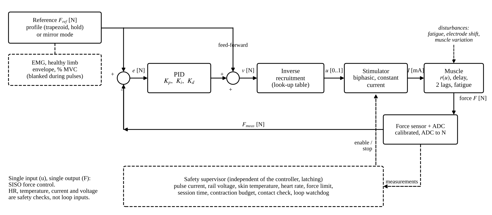
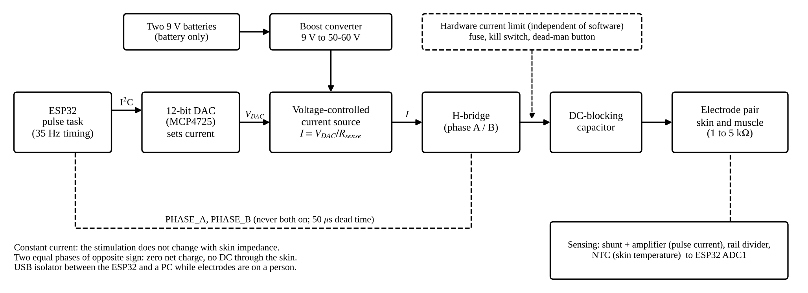
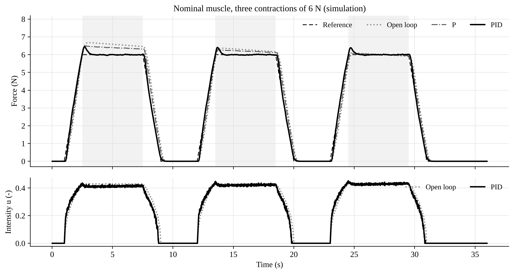
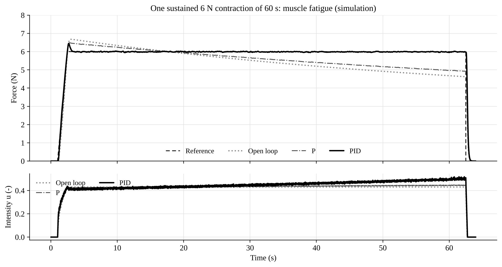

# Muscle Stimulation using PID Control

Closed loop force control of electrically stimulated muscle: a stimulator with a force sensor,
a PID controller that works through an identified recruitment curve, a safety supervisor, a
simulation study, and the tools to calibrate and identify the real system.

> **Safety.** This drives current through the body. Read [SAFETY.md](SAFETY.md)

## The control problem



One input (stimulation intensity `u`), one output (force in N): a **SISO** loop. The controller works in the
force-demand domain: reference plus PID correction gives a demand `v` in N, and an identified inverse
recruitment table converts it to `u`. Heart rate, skin temperature, pulse current and rail voltage are
safety checks. Mirror mode sets the reference from the EMG of the healthy opposite limb (in % of its maximum
voluntary contraction).



## Simulation results (simulated, 5 noise seeds)

| Scenario | Open loop | P | PI | PID |
|---|---|---|---|---|
| Nominal 6 N trapezoids, RMSE (N) | 0.454 | 0.304 | 0.133 | 0.120 |
| Plant gain x 0.7, RMSE (N) | 1.181 | 0.908 | 0.240 | 0.207 |
| Plant gain x 1.3, RMSE (N) | 1.605 | 1.020 | 0.165 | 0.136 |
| 60 s hold with fatigue, final force / initial force | 72 % | 79 % | 99.9 % | 99.9 % |

Feedback removes the effect of fatigue and gain changes. Inverse recruitment cuts the PI error by a factor of
2.3 to 3 at every amplitude. PID is only slightly better than PI and moves the output about three times more,
so PI is the default. The plant is a model with assumed parameters, see [docs/theory.md](docs/theory.md).




Poster (A1 landscape): [docs/poster/poster.pdf](docs/poster/poster.pdf), source `docs/poster/poster.html`.

## Repository layout

```
firmware/muscle_stim_pid/   ESP32 sketch (.ino) and portable core headers (controller, safety, EMG, FSR, profiles)
firmware/test/              host unit tests, controller trace for the cross-check, stub headers, Makefile
python/muscle_stim/         model, controllers, identification, simulations, FSR calibration, logger, analysis
python/tests/               pytest suite (includes the C++ vs Python controller check)
data/sim/                   simulation outputs (metrics.csv, trial logs, identified tables)
data/measured/              put real session logs here
docs/                       theory, hardware, protocol, figures, poster
```

## Quick start

```
pip install -r requirements.txt
PYTHONPATH=python python -m pytest python/tests -q          # Python tests + C++ cross-check (needs g++)
PYTHONPATH=python python -m muscle_stim.run_simulations     # regenerates data/sim and docs/figures
PYTHONPATH=python python -m muscle_stim.diagrams            # block diagrams
cd firmware/test && make test                               # C++ unit tests and sketch syntax check
```

On Windows set `PYTHONPATH` with `set PYTHONPATH=python`. The simulation output is deterministic (fixed seeds).

## Firmware

Arduino IDE, board "ESP32 Dev Module" (Arduino-ESP32 2.x or 3.x). Open `firmware/muscle_stim_pid/muscle_stim_pid.ino`.
Install the library "SparkFun MAX3010x Pulse and Proximity Sensor Library", or set `USE_HEART_RATE 0` in `config.h`
(then heart rate is no longer a safety input). All settings and limits are in `config.h` and the compile-time
checks reject unsafe values. Commands and telemetry: [docs/protocol.md](docs/protocol.md).

Order of work: dummy-load tests, FSR calibration, staircase, step, gains, closed loop
([docs/hardware.md](docs/hardware.md)). Until `FSR_CALIBRATED` and `RECRUIT_IDENTIFIED` are set to `true` the
firmware refuses to arm and to run closed loop.


